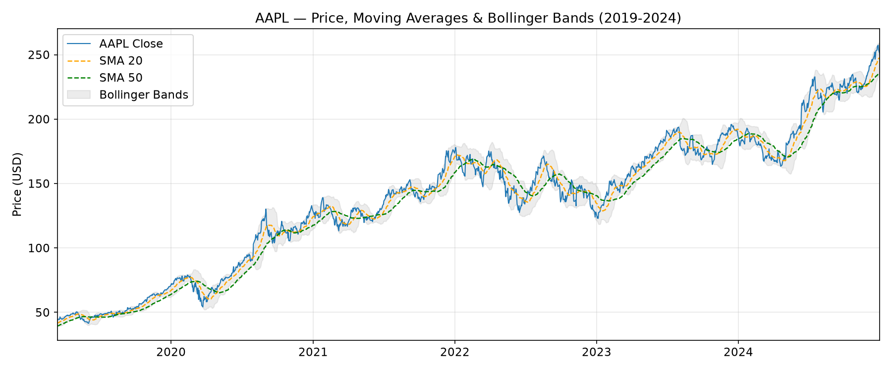
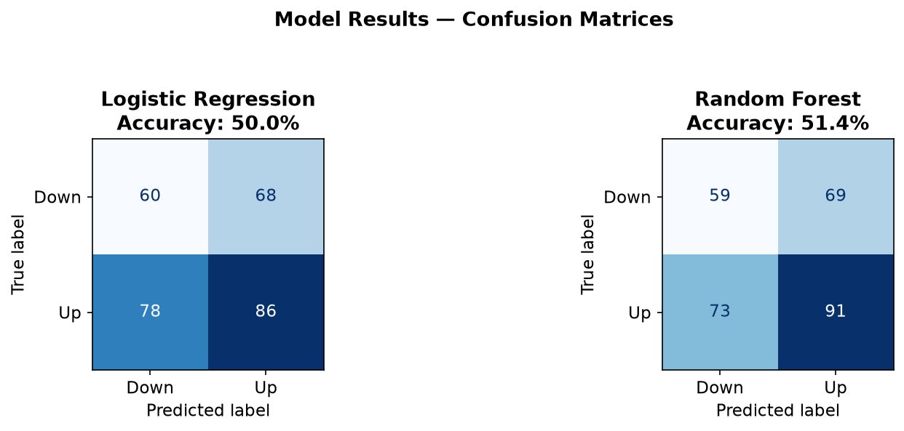
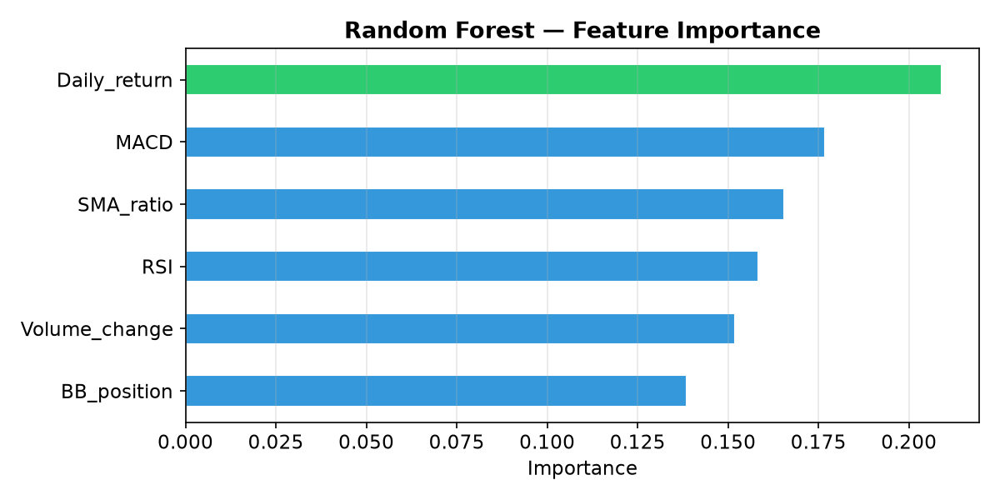

# Stock Market Trading Agent — AI Final Exam

Predicts next-day price direction (up/down) for AAPL from engineered technical
indicators, comparing a Logistic Regression baseline against a Random Forest
classifier.

## Pipeline

1. **Data** — downloads AAPL OHLCV data (2019–2024) with `yfinance`.
2. **Feature engineering** — RSI (14-day), SMA 20/50 ratio, Bollinger Band
   position, MACD, daily return, volume change.
3. **Label** — whether tomorrow's close is higher than today's.
4. **Split** — temporal 80/20 train/test split (no shuffling, so no look-ahead
   data leakage).
5. **Models** — Logistic Regression (scaled features) and Random Forest
   (200 trees, max depth 6).
6. **Evaluation** — accuracy, classification report, confusion matrices,
   feature importance.
7. **Reporting** — `build_slides.py` turns the generated charts into a slide
   deck (`python-pptx`).

## Results







This project's main goal was to practice the end-to-end ML workflow — feature
engineering, leakage-safe evaluation, and comparing models — rather than to ship a
profitable trading strategy. Next-day price direction from technical indicators alone
is close to a random walk, so accuracy was modest; the exercise was as much about
critically reading those results (what the features can and can't capture, and what
problem domains are actually a good fit for this approach) as about the model itself.

## Running

```bash
pip install -r requirements.txt
python trading_agent.py       # trains models, saves charts to slides_output/
python build_slides.py        # builds the presentation deck from those charts
```
